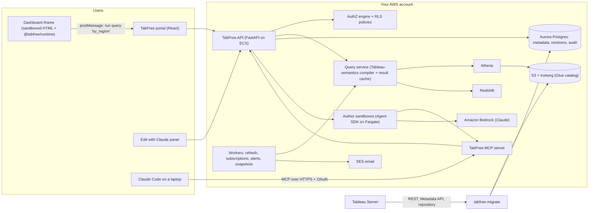
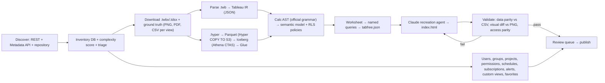
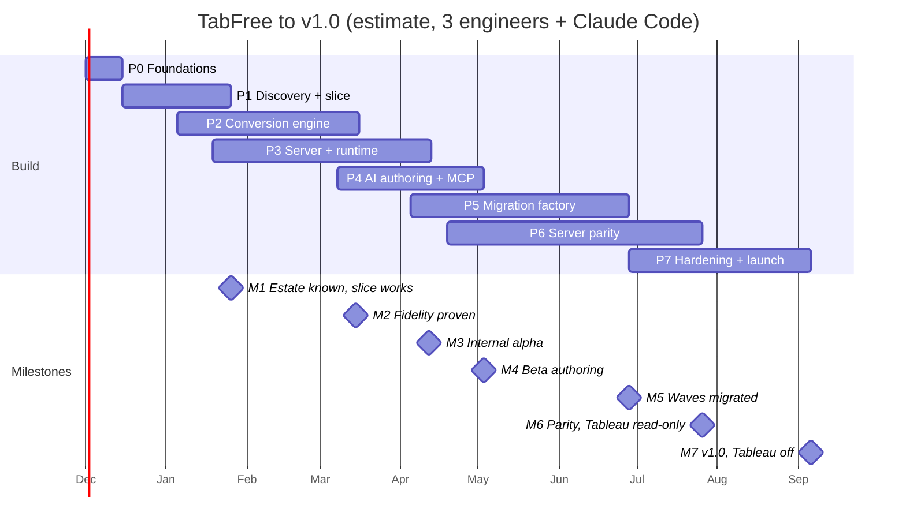

# TabFree build plan

> **Working name:** "TabFree" is a codename. Salesforce's trademark rules forbid using "any recognizable portion" or abbreviation of the Tableau mark in a product or domain name, so pick and clear a public name before the repo goes public (task P0.7, risk R1).
>
> **Date:** 2026-11-20. **Based on:** [the research report](research/research-report.md) and the notes in [`docs/research/notes/`](research/notes/).

---

## 1. What we are building

TabFree is a free, open-source (Apache-2.0) replacement for Tableau Server plus Tableau Desktop that runs in your own AWS account.

| Tableau today | TabFree |
|---|---|
| Tableau Desktop / web authoring (drag and drop) | **Claude writes the dashboards as HTML.** Users edit them in the browser through a built-in "Edit with Claude" panel. Developers can also use Claude Code on their laptops through TabFree's MCP server. |
| Hyper extracts (`.hyper`, `.tde`) stored on Tableau Server | **No extract engine.** Data lives in S3 as Iceberg tables, or in Redshift, and is queried natively by Athena or Redshift. |
| Tableau Server: sites, projects, permissions, RLS, schedules, subscriptions, alerts | **The same governance concepts**, implemented to behave like Tableau so that migrated permissions mean the same thing. |
| Moving off Tableau means a manual rebuild | **A migration factory.** It inventories, converts and verifies every workbook, data source, extract, user, group, permission, schedule and subscription against Tableau's own numbers. |

## 2. Research verdict in brief

- **Nothing does all of this today, open source or commercial.** The closest things each cover one slice and are tied to a paid platform:
  - **Tableau Data Apps:** Tableau's own beta from November 2026, in which Claude writes HTML/JS apps through Tableau's MCP server. It needs paid Tableau editions.
  - **Lightdash "data apps":** AI-written apps in sandboxed iframes, but enterprise-licensed.
  - **Commercial converters:** AWS Transform → Quick Sight, Databricks, Snowflake Cortex Code → Streamlit, Sigma, and Power BI converters. Each one locks you into its own destination.
  - **Apache Superset:** an open-source server, but its dashboards are not HTML.
  - **[unshackle](https://github.com/Querio-App/unshackle):** Apache-2.0, migration only. It is one month old.
- **Nobody has built:**
  - an open server that hosts migrated Tableau content with enforced permissions, schedules and subscriptions on Athena or Redshift
  - a Tableau formula to Athena/Redshift SQL compiler that handles LODs and table calcs
  - a Tableau-worksheet-to-web-chart converter
  - a migrator for subscriptions, schedules and alerts

  These gaps are TabFree's core.
- **TabFree's defensible core is fidelity, not AI authoring.** Tableau, Lightdash, Sigma, Snowflake and Databricks all ship AI authoring in some form. What nobody offers openly is:
  - a compiler that makes Athena and Redshift return Tableau's numbers
  - an engine that reproduces Tableau's effective access
  - a conformance corpus that proves both
- **What we can reuse (all permissively licensed):**
  - **Tableau's own open-source pieces:**
    - Hyper API (Apache-2.0 since July 2024)
    - official TWB XSD schemas (`tableau/tableau-document-schemas`)
    - official ANTLR grammar for the calculation language (`TableauCalculationGrammar.g4` in `tableau/Tableau-AI-Model-Evaluation-Tool`)
    - TDVT, about 860 calc test files (MIT)
    - Tableau Server Client (TSC)
    - Tableau MCP
    - VizQL Data Service SDK
    - the repository data dictionary
  - **Third-party libraries:** SQLGlot (Athena, Redshift and Tableau dialects), pantab, Vega-Lite, ECharts, Perspective, MapLibre, Playwright, OpenFGA.
  - **Designs we can learn from:** Lightdash data apps and MCP Apps.

---

## 3. Architecture decisions (convert each to an ADR in Phase 0)

| # | Decision | Choice | Why | Rejected alternative |
|---|---|---|---|---|
| ADR-001 | Build new or extend an existing BI server | **Build a new, purpose-built server**, borrowing patterns from Superset, Lightdash and the Migration SDK | <ul><li>TabFree's content model (sites, nested projects, Tableau capability permissions, HTML dashboard bundles) and its query semantics (LOD, filter order of operations) are foreign to Superset's chart-plugin dashboards and its role model.</li><li>Grafting both on would be a deep fork that has to keep tracking upstream.</li><li>Claude Code makes greenfield development fast, and a codebase designed for AI maintenance is an asset.</li></ul> | <ul><li>**Extend Apache Superset with an "HTML dashboard" extension:** reuses RBAC, alerts and embedding, but the Tableau permission model and HTML dashboards would run parallel to Superset's own. A time-boxed spike (P1.14) tests the report's two falsifiable questions; if both pass, we extend Superset instead.</li><li>**Fork Lightdash:** its key parts are enterprise-licensed.</li></ul> |
| ADR-002 | Dashboard format | **An HTML bundle plus a governed data contract.** Claude writes HTML using TabFree web components (`<tf-chart>`, `<tf-filter>`, …). All data comes only from named semantic queries declared in `tabfree.json` and executed by the server. A dashboard built only from components has no custom JS and can be checked statically, so it is effectively a spec. Custom JS is the escape hatch and gets an extra review gate. | <ul><li>Honours "HTML is easiest for AI".</li><li>Governance lives in the manifest, which the server validates and enforces, not in the HTML.</li><li>Components give Tableau-like consistency, and PDF rendering and diffs stay deterministic.</li><li>Confirmed or revised by the authoring eval (P1.15).</li></ul> | <ul><li>**A governed JSON dashboard spec with HTML widgets only as the escape hatch:** the research report's default. Safer for patch-style edits, but further from what you asked for. If the eval shows HTML is less reliable, we switch, and the data contract carries over unchanged.</li><li>**Raw HTML with direct SQL:** ungovernable.</li></ul> |
| ADR-003 | Semantic layer and query engine | **Our own Tableau-semantics compiler** in Python on SQLGlot: a VizQL-style planner with Tableau's order of operations, FIXED/INCLUDE/EXCLUDE as staged CTEs, native-grain relationships, blending, and totals. A spike (P2.11) decides the execution and caching layer: Cube Core (pre-aggregations, caching, policies) runs the compiled SQL, or our governed service runs it directly. Apache Ossie for import/export later. | <ul><li>Fidelity to Tableau's numbers is the product's core promise.</li><li>No existing semantic layer models INCLUDE/EXCLUDE LODs that depend on the view's grain, or Tableau's filter staging.</li><li>TDVT and VizQL Data Service give us a test oracle.</li></ul> | <ul><li>**Cube Core as the semantic model itself:** a mismatch on LODs and table calcs.</li><li>**dbt MetricFlow:** no RLS and no caching.</li><li>**LLM translation per calculation:** kept only as a gated fallback.</li></ul> |
| ADR-004 | Where table calcs run | **Both.** SQL window functions when the partition is large. A JS table-calc engine in the runtime is the source of truth for densification, `PREVIOUS_VALUE`, non-additive `TOTAL` and secondary calcs. | Tableau itself computes table calcs locally over the view's result table. | SQL only (cannot reproduce densification or `PREVIOUS_VALUE` cleanly). |
| ADR-005 | Languages | **Python 3.12** for the API, compiler, migration, workers and MCP server; **TypeScript** for the portal, runtime and components | <ul><li>The Tableau tooling (Hyper API, TSC, pantab) and SQLGlot are Python.</li><li>The browser runtime is TypeScript.</li><li>Two languages, no more.</li></ul> | All-TypeScript (would lose SQLGlot and Hyper API parity). |
| ADR-006 | Permissions | **A Tableau-compatible permission engine** in the app, rules stored in Postgres: site-role ceilings, capabilities per content type, allow/deny, user rules over group rules, deny wins among groups, project defaults, locked projects, owners and project leaders. It sits behind an interface, and one Tableau effective-permission test matrix decides the backend: a plain Postgres evaluator, embedded Cedar (deny-wins via `forbid`; unshackle already emits Cedar), or OpenFGA (fast permission-filtered browse at scale). | One fewer service for self-hosters, and exact Tableau semantics we can test exhaustively. | OpenFGA from day one, as the architecture research suggests: kept as a backend option, chosen if the matrix or list-filtering performance calls for it. |
| ADR-007 | Data storage | **Iceberg (v2) on S3 in the Glue Data Catalog, queried by Athena** by default. **Redshift (Serverless or provisioned)** for live warehouse sources and heavy concurrency. Row-level security is enforced in the compiler, with coarse Lake Formation/IAM grants as a backstop. | <ul><li>Iceberg gives atomic refresh, `MERGE` for incremental refresh, and snapshots.</li><li>Athena has no idle cost.</li><li>App-side RLS works the same on both engines and keeps caching possible (Lake Formation fine-grained access disables Athena result reuse).</li></ul> | Loading everything into Redshift (more cost, no benefit for small extracts). |
| ADR-008 | AI runtime | **Claude Agent SDK in a per-session sandbox** (an ECS Fargate task, no general internet egress), with Claude via Amazon Bedrock by default or the Anthropic API. A fast in-process tool loop handles small edits. The AI module is optional and pluggable. | <ul><li>Bedrock keeps data in AWS.</li><li>Per-session isolation.</li><li>The Agent SDK is under Anthropic's commercial terms rather than an OSI license, so TabFree must also run with AI switched off.</li></ul> | Running Claude Code unsandboxed on the API host. |
| ADR-009 | Infrastructure | **ECS Fargate, Aurora PostgreSQL, S3, SQS, EventBridge Scheduler, SES and Cognito** (as an OIDC/SAML broker), deployed with **Terraform/OpenTofu**. `docker compose` for local development; a Helm chart for EKS later. | <ul><li>No cluster to run.</li><li>One task per agent session.</li><li>Small installs cost roughly $275 a month for infrastructure plus Claude tokens (estimate, research §AWS).</li></ul> | <ul><li>EKS-first (heavier).</li><li>CDK (fine, but smaller OSS reach).</li></ul> |
| ADR-010 | License | **Apache-2.0** | <ul><li>Explicit patent grant.</li><li>Compatible with the Hyper API, SQLGlot, Vega-Lite, ECharts, Perspective and Playwright.</li><li>Enterprise-friendly.</li></ul> | AGPL (deters adopters and embedders). |
| ADR-011 | Calculation language | **Tableau's formula syntax** stays TabFree's user-facing calculation language, compiled by our compiler | <ul><li>Migrated calcs are kept verbatim.</li><li>Analysts' skills stay useful.</li><li>Every Claude edit goes through the same compiler and conformance tests.</li></ul> | A new expression language, or SQL snippets (lose verbatim migration, and SQL breaks dialect portability). |

---

## 4. Target architecture



### 4.1 The dashboard bundle (ADR-002)

```
dashboards/sales-overview/
  tabfree.json   # data contract: model, parameters, filters, named queries, actions (validated by the server)
  index.html     # written by Claude; uses <tf-*> components and/or custom JS
  app.js         # optional custom logic (no network access; data only via tabfree.query)
  style.css      # optional
  assets/        # images, custom shapes from the .twbx
```

```jsonc
// tabfree.json (illustrative)
{
  "schema": "tabfree/dashboard@1",
  "title": "Sales Overview",
  "model": "superstore_sales",                       // semantic model, carries RLS
  "parameters": { "top_n": { "type": "integer", "default": 10, "range": [1, 50] } },
  "filters": {
    "region":     { "field": "Region", "kind": "categorical", "multi": true, "appliesTo": ["by_region", "trend"] },
    "order_date": { "field": "Order Date", "kind": "relative_date", "default": "last_12_months", "context": true }
  },
  "queries": {
    "by_region": { "dimensions": ["Region"], "measures": ["SUM(Sales)", "Profit Ratio"],
                   "sort": [{ "by": "SUM(Sales)", "dir": "desc" }] },
    "trend":     { "dimensions": [{ "field": "Order Date", "grain": "month" }], "measures": ["SUM(Sales)"],
                   "tableCalcs": [{ "name": "Running Sales", "type": "running_sum", "of": "SUM(Sales)",
                                    "addressing": ["Order Date"] }] }
  },
  "actions": [{ "type": "filter", "source": "by_region", "targets": ["trend"], "fields": ["Region"] }]
}
```

```html
<!-- index.html (illustrative) -->
<tf-dashboard layout="tiled">
  <tf-filter name="region" style="dropdown"></tf-filter>
  <tf-filter name="order_date" style="relative-date"></tf-filter>
  <tf-chart query="by_region" mark="bar" x="SUM(Sales)" y="Region" color="Profit Ratio"></tf-chart>
  <tf-chart query="trend" mark="line" x="Order Date" y="Running Sales"></tf-chart>
</tf-dashboard>
<script type="module">
  // Free-form code is allowed; data still only flows through the governed contract.
  const rows = await tabfree.query("by_region");
</script>
```

**Security model:**
- Dashboards render in an iframe on a separate origin with `sandbox="allow-scripts"`, without `allow-same-origin`.
- A strict CSP applies: `connect-src 'none'`, scripts only from the runtime bundle and the bundle itself.
- No tokens or cookies ever enter the frame.
- The frame asks the parent page for data by query name. The API then:
  1. checks the user's capability on the dashboard and the model,
  2. compiles the named query with the user's RLS policy and current filter/parameter bindings,
  3. binds values as parameters, caps rows and bytes, and executes.
- Ad-hoc semantic queries (explore mode, and the agent's `run_governed_query`) need the Explore or Web Edit capability. Raw SQL is an admin-only tool.

### 4.2 The migration pipeline



---

## 5. Tech stack

| Layer | Choice |
|---|---|
| API and services | Python 3.12, FastAPI, Pydantic v2, SQLAlchemy 2, Alembic, uv |
| Query compiler | SQLGlot (dialects `athena`, `redshift`, plus `trino` locally), ANTLR4 Python target for the official Tableau calc grammar |
| Data access | boto3: Athena `StartQueryExecution` with workgroups and `ExecutionParameters`; Redshift Data API |
| Extract conversion | `tableauhyperapi` (Apache-2.0), pantab, PyArrow, PyIceberg (optional) |
| Tableau access | `tableauserverclient` (TSC), Metadata API (GraphQL), repository (read-only Postgres), VizQL Data Service SDK |
| Portal | React + TypeScript + Vite, TanStack Router/Query |
| Dashboard runtime | `@tabfree/runtime` (TypeScript) with web components; Vega-Lite (default charts), ECharts (maps, treemaps, large data), Perspective / TanStack Table (crosstabs), MapLibre + deck.gl (maps) |
| Snapshots and exports | Playwright (Chromium) workers |
| AI | Claude Agent SDK in Fargate sandboxes; Claude via Amazon Bedrock (default) or the Anthropic API; official MCP Python SDK (Streamable HTTP, OAuth 2.1); MCP Apps for in-chat previews |
| Identity | OIDC (Cognito broker by default; Okta, Entra ID or Keycloak direct), SAML through the broker, local accounts, PATs, SCIM 2.0 endpoint |
| Platform | ECS Fargate, Aurora PostgreSQL, S3, Glue, Athena, Redshift, SQS, EventBridge Scheduler, SES, Secrets Manager, KMS, CloudWatch |
| Local dev | `docker compose`: Postgres, Trino + Iceberg REST catalog + MinIO (Athena stand-in), LocalStack (SQS/SES) |
| IaC and CI | Terraform/OpenTofu modules, GitHub Actions; nightly dialect tests against real Athena and Redshift in a sandbox account |

## 6. Repository layout

```
tabfree/
  apps/
    api/            # FastAPI: auth, authz, content, revisions, query API, admin, SCIM, embed
    web/            # React portal
    worker/         # scheduler consumers: refresh, subscriptions, alerts, snapshots
    author/         # AI authoring sandbox image (Agent SDK) + session orchestration
  packages/
    schemas/        # JSON Schemas: Tableau IR, semantic model, dashboard manifest
    compiler/       # tabfree-compiler: calc grammar/AST, expression translator, query planner, table calcs
    migrate/        # tabfree-migrate: crawler, downloader, ground truth, TWB parser → IR, hyper converter
    runtime/        # @tabfree/runtime: sandbox bridge, SDK, <tf-*> components, JS table-calc engine
    mcp/            # TabFree MCP server
    cli/            # `tabfree` CLI (login, pull, push, preview, migrate)
  infra/
    terraform/      # AWS modules
    docker/         # local stack
  corpus/           # test workbooks + captured ground truth + expected outputs
  docs/
    adr/            # architecture decision records
```

---

## 7. Phases and milestones

**Team assumption:** 3 engineers using Claude Code heavily (backend/data, front-end/runtime, migration/AI), plus a part-time product owner who is also a Tableau Server admin. Phases overlap. Phases advance on their exit criteria (gates), not on dates. Week numbers are estimates to revisit at the end of Phase 0.

### Phase 0: Foundations and decisions (weeks 1–2)

**Goal:** decisions locked, repo and CI ready, local stack running, Tableau Server access arranged, test corpus assembled.

- [ ] **P0.1** Monorepo with Apache-2.0 `LICENSE`, `NOTICE`, `README`, `CONTRIBUTING`, `CODE_OF_CONDUCT`, `SECURITY.md`. CI: ruff, mypy, pytest; eslint, tsc, vitest; pre-commit; a `CLAUDE.md` with build and test conventions.
- [ ] **P0.2** ADR-001 to ADR-011 written up in `docs/adr/`.
- [ ] **P0.3** `make dev` brings up the local stack: Postgres, Trino + Iceberg REST catalog + MinIO, LocalStack.
- [ ] **P0.4** AWS sandbox account via Terraform: VPC, S3 buckets (raw, lake, query results), Glue database, Athena workgroup, small Redshift Serverless, Aurora, ECS cluster, ECR, Secrets Manager, Bedrock model access.
- [ ] **P0.5** Test corpus (target 30+ workbooks):
  - Tableau samples such as Superstore
  - TDVT workbooks and expression files
  - openly licensed community workbooks
  - about 20 sanitized workbooks from our own server
- [ ] **P0.6** Tableau Server access:
  - Service account plus a connected app, so it can sign in as any user for RLS checks, or PATs.
  - Enable the Metadata API: `tsm maintenance metadata-services enable`.
  - Enable read-only repository access: `tsm data-access repository-access enable`.
  - Record the REST API version from `GET /api/{v}/serverinfo`.
  - Confirm a network path from AWS to Tableau Server.
- [ ] **P0.7** Name: keep "TabFree" internal. Shortlist public names, run a clearance search (USPTO/EUIPO, classes 9 and 42), and register the domains.
- [ ] **P0.8** v0 JSON Schemas for the Tableau IR, the semantic model and the dashboard manifest.

**Exit criteria:**
- CI is green.
- The local stack boots.
- A smoke script lists sites, projects and workbooks on our Tableau Server.
- The corpus is in `corpus/`.

### Phase 1: Discovery and vertical slice (weeks 2–8)

**Goal:** know exactly what we are migrating, preserve Tableau's ground truth before it can be lost, and prove the whole architecture end to end on three real dashboards.

*Track A: discovery (`tabfree-migrate discover | extract`)*
- [ ] **P1.1** Crawler over TSC/REST covering:
  - sites and server info
  - users (site role, auth, IdP id, last login), groups (local and IdP-synced) and members
  - projects tree (owner, `contentPermissions` / locked)
  - workbooks, views (including hidden-sheet detection), data sources and connections
  - explicit and default permissions
  - schedules and extract refresh tasks
  - subscriptions, custom views, favorites, tags, webhooks

  Results go to a manifest DB keyed by `(server, site LUID, type, LUID, updatedAt)`. The crawler is resumable, backs off on 429/5xx, and supports incremental runs with `updatedAt:gte`.
- [ ] **P1.2** Metadata API harvest:
  - workbook → sheet → field lineage, with calculated-field formulas
  - custom SQL and upstream tables/databases
  - published data source dependencies
  - `hasUserReference` flags (RLS)

  Page under the 20,000-node limit.
- [ ] **P1.3** Repository harvest (Server only):
  - usage (`views_stats`, `http_requests`, `historical_events`)
  - subscription and data-driven-alert details that REST does not return
  - comments
  - extract and workbook sizes
- [ ] **P1.4** Downloads: `.twbx`/`.tdsx` with `includeExtract=false` first, then extracts selectively. Stream to the S3 raw zone with content hashes.
- [ ] **P1.5** Ground truth for each in-scope view:
  - high-resolution PNG at a fixed `vizWidth`/`vizHeight`
  - PDF
  - summary CSV (Query View Data)
  - crosstab
  - for the top views by usage, filter and parameter permutations through `vf_<field>=` and `vf_Parameters.<name>=`

  **Do this early: this evidence is gone once Tableau is switched off.**
- [x] **P1.6** Inventory report covering:
  - a **construct census**: every calc function, LOD, table-calc type, mark type, filter type and action type counted across all `.twb` files, so the P0 backlog is sized from our own estate rather than vendor rubrics
  - counts and sizes
  - connection types, and which sources sit outside AWS
  - live vs extract
  - RLS usage and usage per view
  - a **complexity score** per workbook (LODs, table calcs, parameters and actions, blending, custom SQL, user functions, extensions, maps)
  - **triage**: migrate / rebuild / retire (e.g. retire anything with no views in 180 days, after owner confirmation)
- [x] **P1.7** Evaluate reuse, with a written decision for each:
  - unshackle (Apache-2.0) as a base for the crawler and RLS/permission extraction
  - Preset's `tableau-to-preset` skill and Sigma's migration skills, for the conversion prompts

*Track B: vertical slice (3 dashboards from the inventory: one with an LOD, one with table calcs, one with a map and actions)*
- [x] **P1.8** Minimal TWB parser → IR for those workbooks.
- [ ] **P1.9** `.hyper` → Parquet (Hyper `COPY ... TO` S3) → Iceberg through Athena CTAS → Glue. Row-count and aggregate parity checks.
- [x] **P1.10** Hand-written semantic models and named queries, and a minimal compiler path (dimensions, measures, categorical and date filters) on Athena.
- [x] **P1.11** Minimal runtime: sandboxed iframe, postMessage bridge, `tf-chart`, `tf-filter`, `tf-crosstab`.
- [ ] **P1.12** Claude Code recreates the three dashboards as HTML from IR + PNG (a manual loop for now).
- [x] **P1.13** Minimal API: OIDC login, two users with different permissions, one RLS rule.

*Track C: decision spikes (time-boxed, results recorded as ADR updates)*
- [ ] **P1.14** Superset spike (3 days), with two falsifiable questions:
  - Can a `.supx` extension host a sandboxed dashboard content type whose queries proxy through Superset's data API?
  - Can Superset's roles pass the Tableau effective-permission test matrix without forking?

  If both pass, ADR-001 flips to "extend Superset".
- [ ] **P1.15** Authoring eval: HTML + `<tf-*>` components vs a JSON spec, and Vega-Lite vs ECharts. Claude rebuilds 20 corpus dashboards each way. Measure:
  - spec/HTML validity and render success
  - data correctness and visual similarity
  - success on 10 scripted change requests
  - tokens used

  The result confirms or revises ADR-002.
- [ ] **P1.16** First Athena vs Redshift Serverless latency probe on real converted extracts (cold, warm, concurrent), feeding P2.10.

**Phase 1 status (2026-11-20).** Everything that runs without our Tableau Server or an AWS account is built and tested (`make check`). The rest waits for the server (held back until the platform is mostly built) or for an AWS go-ahead.

| Task | Status |
|---|---|
| P1.1 crawler | Built (`tabfree-migrate crawl`); tested against fakes, not yet run on our server. |
| P1.2–P1.5 harvests, downloads, ground truth | Built (`harvest-metadata`, `harvest-repository`, `download`, `capture`); tested against fakes. Metadata API field names and repository tables need checking on the live server. |
| P1.6 inventory report | Done (`tabfree-migrate report`). Over the public corpus: 96 workbooks, 85 migrate / 11 rebuild, 56 of 156 connections outside AWS, 26 workbooks with RLS functions; regex functions are the top compiler gap. |
| P1.7 reuse | Done: borrow ideas, adopt nothing ([notes](research/notes/p1-7-reuse-evaluation.md)). |
| P1.8 parser | Done: all 123 corpus files parse to schema-valid IR. |
| P1.9 Hyper → Iceberg | Built; the Hyper test runs only in the Linux CI job. The Athena CTAS step needs AWS. |
| P1.10 compiler | Done: 771/779 TDVT on DuckDB; SQL parses for Athena, Redshift and Trino ([ADR-012](adr/0012-hand-written-calc-parser.md) proposed). |
| P1.11 runtime | Done: sandbox, bridge, SDK, `tf-chart/crosstab/kpi/map/filter/parameter`. |
| P1.12 recreations | Done on corpus workbooks with Superstore data ([notes](migrations/p1-12-recreations.md)); repeat on three dashboards from our server with PNG/CSV ground truth. |
| P1.13 API | Done: OIDC + PKCE, sessions, ADR-006 permission order, governed query API with RLS. |
| P1.14 Superset spike | Desk phase done: both questions fail ([notes](research/notes/p1-14-superset-spike.md)). Hands-on (~1.5 days) still to do. |
| P1.15 authoring eval | Pilot of the HTML arm done: 11/11 edits ([notes](research/notes/p1-15-authoring-pilot.md)). The JSON-spec arm, renderer comparison and semantic checker are still to do. |
| P1.16 latency probe | Harness built (`python -m tabfree_api.probe`); needs AWS. |

**Milestone M1, "We know the estate, and the idea works":**
- Decisions from P1.14–P1.16 are recorded in the ADRs.
- The inventory report is reviewed.
- Ground truth is captured for every in-scope view.
- Three real dashboards run in TabFree on Athena, with numbers matching Tableau's CSVs.
- Stakeholder demo held.

### Phase 2: Conversion engine (weeks 6–16)

**Goal:** Tableau's calculation and query semantics, reproduced faithfully on Athena and Redshift.

- [x] **P2.1** Full TWB/TDS parser → Tableau IR:
  - **Normalisation:** `_.fcp.*` feature-flag element names; version read from `source-build`, not `version='18.1'`.
  - **Data sources:** connections, named connections, relations, joins, unions, custom SQL, relationships (object graph), extract settings.
  - **Columns:** calcs, parameters, groups, sets, bins, hierarchies, aliases, folders, default formats, geographic roles.
  - **Worksheets:** the shelf field-reference grammar `[ds].[derivation:field:qk|nk|ok]` with `/` `+` `*`, panes and encodings, mark classes, filters (categorical, quantitative, relative-date, top-N, context), sorts, `<table-calc>` settings, totals.
  - **Dashboards:** zones tree, floating zones, device layouts, text/image/web zones.
  - **Actions:** filter, highlight, URL, go-to-sheet, parameter, set.
  - **Stories.**
  - **Validation:** against the official XSD, keeping a list of known deviations.
  - **Target:** 100% of the corpus parses.
- [x] **P2.2** Calc parser: vendor `TableauCalculationGrammar.g4` (Apache-2.0) → typed AST. Build the dependency DAG and classify each calc as row-level, aggregate, LOD or table calc.
- [x] **P2.3** Expression translator: AST → SQLGlot → `athena` / `redshift`.
  - Full function map.
  - Semantics shims:
    - `/` is float division and returns NULL on a zero divisor
    - `IIF` with a NULL test returns NULL
    - `INT` truncates toward zero
    - `DATEDIFF` counts boundaries crossed
    - week start comes from data source settings
    - fiscal years
    - collation and case behaviour
  - A list of unsupported constructs: `SCRIPT_*`, `MODEL_*`, and `RAWSQL` (needs dialect review).
- [x] **P2.4** Semantic model (YAML) and a generator from Tableau data sources:
  - tables (Iceberg/Redshift), relationships with native-grain aggregation, joins
  - calc fields, parameters, hierarchies, groups, sets, bins
  - formats and aliases
  - RLS policy slots
- [x] **P2.5** Query planner (VizQL-style):
  - grain from shelves and encodings
  - **filters staged in Tableau's order:** extract/data source → context → FIXED → dimension → measure → table calc
  - FIXED/INCLUDE/EXCLUDE as staged CTEs with null-safe joins
  - Top N and sets as semi-joins
  - totals and subtotals via `GROUPING SETS` or extra queries (re-aggregated, never summed)
  - Measure Names/Values
  - blending as a secondary query left-joined on the link fields
  - computed and manual sorts
- [x] **P2.6** Table-calc engine: SQL window push-down templates, plus `@tabfree/tablecalc` in JS (partitioning and addressing, all `RANK_*` variants, `WINDOW_*`, `LOOKUP`, `PREVIOUS_VALUE`, `TOTAL`, densification, secondary calcs, table-calc filters).
- [x] **P2.7** Query service:
  - semantic query API
  - Athena executor (workgroup per site, `ExecutionParameters`, result reuse)
  - Redshift Data API executor
  - row/byte caps and timeouts
  - result cache keyed on `hash(compiled SQL, RLS context, data version)`
  - per-site cost guardrails
- [ ] **P2.8** Extract converter at scale:
  - parallel Fargate jobs
  - type mapping, including geography as WKT
  - extract filters and aggregation become table definitions
  - incremental keys recorded for Phase 6
  - `.tde`: a pinned legacy Hyper API image (the official sample uses 0.0.17537), or flag the extract for upgrade
  - per-column parity (Hyper vs Athena)
- [ ] **P2.9** Conformance suites in CI:
  - **TDVT** expression tests on Athena and Redshift
  - **VizQL Data Service** oracle for calc results (Server 2025.1+)
  - **per-view CSV parity** across the corpus
- [ ] **P2.10** Benchmark Athena vs Redshift Serverless (p50/p95, cold and warm, concurrency) on representative dashboards, and set the default engine by data size.
- [x] **P2.11** Cube spike: can Cube Core run the compiler's staged LOD SQL while handling pre-aggregations, caching and access policies? Decide the execution and caching layer (ADR-003).
- [ ] **P2.12** Release the compiler and the conformance suite as standalone Apache-2.0 packages, with TDVT pass rates published, so other converter projects can build on them.

**Phase 2 status (2026-11-20).** The conversion engine is built and tested offline (`make check`). Runs on Athena, Redshift, our Tableau Server (VizQL Data Service, CSV ground truth) and Fargate wait for AWS or the server.

| Task | Status |
|---|---|
| P2.1 parser | Done: every corpus file parses to `tabfree/tableau-ir@1`, with the shelf grammar, panes, filters, sorts, table-calc settings, dashboards, actions and stories; XSD validation with a list of known deviations. |
| P2.2 calc DAG | Done with the hand-written parser ([ADR-012](adr/0012-hand-written-calc-parser.md), proposed) instead of the vendored ANTLR grammar: `analyze_calcs` gives each calc's kind, dependencies, cycles and unknown references. |
| P2.3 translator | Done: TDVT 1135/1146 (99.0%) on DuckDB across all 8 suites, the rest documented; regex, ISO-8601, DATEPARSE, PERCENTILE, CORR/COVAR, fiscal years; unsupported functions refused with a reason. SQL parses for Athena, Redshift and Trino. |
| P2.4 model generator | Done (`tabfree-migrate generate-model`): 163 corpus models, 97% of 1,368 calcs analyse cleanly; reproduces Superstore totals, LODs, groups and Top N sets. |
| P2.5 planner | Done: staged filters, LODs, sets, totals and subtotals, Measure Names/Values, blending, computed and manual sorts, native-grain relationships; worksheet IR → query (`tabfree-migrate worksheet-query`): 88% of 582 corpus worksheets convert fully, 71% compile against their generated models (the rest mostly lack primary keys or have custom SQL to fix). |
| P2.6 table calcs | Done: `@tabfree/tablecalc` (source of truth, ADR-004) plus SQL window push-down. |
| P2.7 query service | Done: explore API, result cache, guardrails, Athena and Redshift executors (tested with fake clients). |
| P2.8 extract converter | Built (types, settings, `.tde` legacy image, batch runner, parity check, Fargate module); needs AWS to run. |
| P2.9 conformance | TDVT and CSV parity harnesses built; nightly Athena/Redshift workflow dormant until `AWS_CONFORMANCE_ROLE_ARN` is set; VDS client built, needs the server. |
| P2.10 benchmark | Needs AWS (probe harness from P1.16). |
| P2.11 Cube spike | Desk result: our own query service and cache ([notes](research/notes/p2-11-cube-spike.md), ADR-003). |
| P2.12 release | Release workflow ready (trusted publishing), gated on clearing the public name. |

**Milestone M2:**
- At least 95% of TDVT tests pass on both dialects, with the rest documented.
- At least 90% of corpus worksheets return result sets that match Tableau's CSV exports: exact for counts and sums, tolerance-based for floats.
- Every in-scope extract is converted with parity.

### Phase 3: Server platform and dashboard runtime (weeks 8–20)

**Goal:** the governed server people actually log in to.

- [x] **P3.1** API skeleton with Postgres schema and migrations: sites, projects (nested), content (dashboards, data models, connections), immutable revisions, users, groups, memberships, permission rules, `audit_event`.
- [x] **P3.2** AuthN: OIDC (Cognito broker, or Okta/Entra/Keycloak direct), SAML through the broker, local accounts, PATs, secure sessions.
- [x] **P3.3** AuthZ, Tableau-compatible:
  - site roles as ceilings (Creator, Explorer, Explorer-can-publish, Viewer, Site admin)
  - capabilities per content type: View, Filter, Download image/PDF, Download summary/full data, Web Edit (edit with Claude), Share, Subscribe, Overwrite, Move, Delete, Set permissions; Connect for models
  - allow / deny / unspecified
  - user rules over group rules, and deny wins among groups (**verify the exact precedence against Tableau's docs before freezing**)
  - owners and project leaders
  - default project permissions and locked projects
  - list filtering for browse and search
  - a table-driven test suite
- [x] **P3.4** Row-level security:
  - policies on semantic models, keyed on user attributes, groups and entitlement tables
  - `USERNAME()`, `FULLNAME()` and `ISMEMBEROF()` translated
  - non-removable data source filters
  - enforced in the compiler and tested with impersonated personas
- [x] **P3.5** Portal:
  - **Navigation:** Home, Explore (project tree), search, favorites/recents.
  - **Content pages:** dashboard viewer (tabs for multi-dashboard workbooks), data model browser.
  - **Admin:** Tableau-style permissions dialog, user/group admin, site settings.
- [ ] **P3.6** Dashboard runtime:
  - bundle loader on a separate usercontent origin, with iframe sandbox and strict CSP
  - postMessage bridge
  - SDK: `query`, filters, parameters, actions, selection/highlight, drill, sort, export hooks, theme
  - components:
    - `tf-dashboard`: tiled and floating containers, fixed and automatic sizing
    - `tf-chart`: Vega-Lite or ECharts
    - `tf-crosstab`: nested headers, totals and subtotals
    - `tf-map`: MapLibre plus open boundary data in place of Tableau geocoding
    - `tf-filter`: every Tableau control style (dropdown, list, slider, date range, relative date, wildcard)
    - `tf-parameter`, `tf-legend` (with highlight), `tf-kpi`, `tf-text`, `tf-image`
- [ ] **P3.7** Exports: PDF/PNG through Playwright, rendered as the requesting user; crosstab CSV/Excel; summary and full data. Every export checks capabilities.
- [x] **P3.8** Audit log (sign-in, view, export, query hash, permission decisions) and basic admin views.
- [x] **P3.9** Old-URL redirects: Tableau `/#/site/<site>/views/<workbook>/<sheet>` → the matching TabFree dashboard, so bookmarks and links in emails keep working.

**Phase 3 status (2026-11-20).** Built and tested offline (`make check`; the database tests also run on Postgres 16 locally and on Postgres 17 in CI). Not yet run with a real identity provider, on AWS or with Chromium installed.

| Task | Status |
|---|---|
| P3.1 metadata database | Done: SQLAlchemy Core schema and four Alembic migrations. It covers sites, users, site roles, groups, nested projects, content with append-only revisions (enforced by a Postgres trigger), rules, sessions, tokens, favorites, old URLs and the audit log. `python -m tabfree_api.db` runs migrations and imports a site file. |
| P3.2 authentication | Done: OIDC (SAML through the broker), sessions in the database, personal access tokens (15-day idle expiry, revocation), local accounts (argon2id, lockout), group minimum roles. Not yet tried against a real Cognito/Okta/Entra tenant. |
| P3.3 authorization | Done: Tableau's documented order, re-checked 2026-11-20 (ADR-006), with table-driven tests. Group sets and per-view permissions are not implemented. |
| P3.4 row-level security | Done: entitlement tables (by username, email or group) and filter policies, both applied before FIXED; user attributes from ID-token claims or the admin. Persona tests on DuckDB. |
| P3.5 portal | Done: React and TanStack: Home, Explore (project tree), search, favorites and recents, the dashboard viewer with workbook tabs, the model browser, the permissions dialog, revisions, users, groups, settings, audit log and tokens. Checked in the browser. |
| P3.6 runtime | Mostly done: the usercontent origin with signed frame URLs and a strict portal CSP; tiled and floating layout with fixed or automatic size; drill, sort and export hooks; nested crosstab headers, pivot and totals; every Tableau filter control style; `tf-legend`, `tf-text`, `tf-image` and `tf-export`. Still open: charts stay on the built-in SVG renderer until P1.15 picks Vega-Lite or ECharts, and `tf-map` needs MapLibre with boundary data (Phase 4). The in-app browser blocks cross-origin frames, so frames on the usercontent origin were checked with HTTP requests rather than visually. |
| P3.7 exports | Partly done: CSV summary data and Excel crosstabs with capability checks, RLS, export caps, table calcs in SQL and formula-injection guards. PNG and PDF are built on Playwright but have not been run with a real Chromium (it needs `playwright install chromium`). Download Full Data (underlying rows) is still to do. |
| P3.8 audit | Done: sign-in and sign-out, views, queries (request hash), exports, denials, permission and admin changes, tokens. Admin audit page. |
| P3.9 old URLs | Done: share and embed links redirect on the server; portal fragment links resolve in the client; mappings are set by an admin or the migration. |

**Milestone M3, internal alpha:**
- Users sign in with SSO and see only what Tableau would have shown them.
- Migrated dashboards open with working filters, highlight and filter actions, sorting and drill.
- PDF and CSV export works.
- RLS is verified with three personas.

### Phase 4: AI authoring, "Edit with Claude" and MCP (weeks 14–22)

**Goal:** users change dashboards on the fly, and developers author them from Claude Code.

- [x] **P4.1** TabFree MCP server (Streamable HTTP, OAuth 2.1, tokens issued on behalf of the user):
  - **Read:** `list_content`, `search_content`, `describe_model` (fields, plus sample values fenced as untrusted).
  - **Query:** `run_governed_query` (semantic queries only).
  - **Dashboard edits:** `get_dashboard`, `create_dashboard`, `edit_dashboard_files` (patch-style).
  - **Checks:** `validate_dashboard`, `preview` (a PNG, plus an MCP Apps `ui://` interactive preview).
  - **Publishing:** `request_publish` / `confirm_publish`.
  - **History:** `list_revisions`, `diff_revisions`.
  - **Docs:** `learn(topic)` serves the component and manifest documentation.
- [x] **P4.2** `tabfree` CLI and a Claude Code kit: `tabfree login | pull | push | preview`, a `CLAUDE.md` and skills for dashboard authoring, and component reference docs.
- [ ] **P4.3** In-app "Edit with Claude":
  - a chat panel beside the dashboard
  - the Author service starts a sandbox (Fargate task: Agent SDK, Claude via Bedrock) with the bundle checked out
  - tools limited to the workspace plus the MCP server; no general egress
  - streaming progress
  - each change becomes a draft revision with a live preview and a diff
  - publishing is gated by the Web Edit/Overwrite capability and an optional approval policy
- [x] **P4.4** Quick-edit path: an in-process tool loop for small edits (target under 30 s), with no sandbox start.
- [x] **P4.5** Validation pipeline, shared with migration:
  - manifest schema check
  - queries compile on both dialects
  - data sanity checks
  - screenshot diff against the previous revision
  - static scan of custom JS (no network APIs, no `eval`)
  - accessibility lint
- [x] **P4.6** Guardrails:
  - per-user permissions on every tool call
  - token budgets and rate limits per user and per site
  - untrusted data fencing (prompt-injection defence)
  - two-step publish
  - every tool call written to `audit_event` with the agent session id
- [x] **P4.7** Provider configuration: Bedrock or the Anthropic API; model per task (a fast model for quick edits, the strongest for multi-tile builds and migration); AI can be switched off entirely.

**Phase 4 status (2026-11-21).** Built and tested offline (`make check`). No real model call has been made, and nothing ran on AWS: the quick-edit loop and the Author service are tested with a scripted model, the Fargate launcher with a fake ECS client, and the sandbox image has not been built.

| Task | Status |
|---|---|
| P4.1 MCP server | Done: Streamable HTTP at `/mcp` (stateless JSON responses, protocol versions 2025-03-26 to 2025-11-25, Origin check), 17 tools with scopes and annotations, an MCP Apps `ui://tabfree/preview` page. OAuth 2.1: RFC 9728 and RFC 8414 metadata, dynamic client registration, S256 PKCE with a consent page, rotating refresh tokens with replay detection, revocation, RFC 8707 resource binding; PATs also accepted. Tested with an in-process client; not yet with Claude Code or Claude Desktop against a deployed server. |
| P4.2 CLI and kit | Done: `tabfree login` (browser OAuth, loopback redirect), `pull`, `push`, `validate`, `diff`, `preview`, `publish` (shows the diff, asks), `kit` (CLAUDE.md, `.mcp.json`, the `tabfree-dashboard` skill). Standard library only; an end-to-end test drives the real API. |
| P4.3 Edit with Claude | Mostly done: the portal's draft page (live preview as the author, chat with streamed progress, diff, files, two-step publish), sessions with follow-up turns, the Fargate launcher (one task per session, no public IP, a 30-minute on-behalf-of token, progress reports) and the Agent SDK image (`apps/author-agent`: only TabFree MCP tools, no settings, turn and dollar caps). Still open: the Terraform for the author cluster, task definition and egress-restricted security group, and running a real session. |
| P4.4 quick edits | Done: an in-process tool loop with the same tools (minus confirm), a cached system prompt with the docs, the draft fenced in the first message, turn, time and token limits. The under-30-seconds target is not yet measured. |
| P4.5 validation | Done: manifest and references (now including the P3.6 components), both dialects, data checks as the author, a custom-script scan that fails network, navigation and dynamic code, accessibility warnings, and a screenshot diff (stdlib PNG decoder) when the renderer is configured. Migration (Phase 5) reuses it. |
| P4.6 guardrails | Done: per-user and per-site daily token budgets (shared in the database), MCP calls per minute per user, fenced data in every tool result, two-step publish that agents cannot confirm, an optional approval policy, and every tool call audited with the agent session id. |
| P4.7 provider | Done: `off` (the default), the Claude API (server-side refusal fallback) or Amazon Bedrock, with a model and effort per task. |

**Milestone M4, beta authoring:**
- A user with Web Edit asks in the browser to "make the region chart stacked and add a YoY column". They review the draft and publish in under 2 minutes.
- A developer builds a new dashboard from Claude Code over MCP.
- Every change is versioned, diffable and audited.

### Phase 5: Migration factory (weeks 18–30)

**Goal:** convert the whole Tableau estate with measurable fidelity, in waves.

- [x] **P5.1** Model generation at scale for every published and embedded data source.
  - Connection remap rules map each Tableau connection to its Athena or Redshift table(s).
  - Unresolved sources (live databases outside AWS, Bridge, Excel) go to a decision queue: Athena federated query, replicate into AWS (DMS / Glue / zero-ETL), or keep a static snapshot.
- [x] **P5.2** Manifest generation: each worksheet becomes named queries, table-calc specs, filters, parameters and actions in `tabfree.json`. This step is deterministic, with no AI involved.
- [ ] **P5.3** Recreation in two stages:
  - **Deterministic baseline:** worksheets become `<tf-chart>`, `<tf-crosstab>` or `<tf-map>` with marks and encodings mapped; the zone tree becomes CSS grid/flex; filter and parameter cards become `<tf-filter>` and `<tf-parameter>`.
  - **Claude repair agent** (batch, headless): starts from the IR, manifest, baseline HTML and reference PNGs, and fixes what the baseline couldn't express (unsupported marks, formatting, custom visuals).
  - **Loop:** validate → render → compare to the Tableau PNG → fix, up to N iterations.
  - **Fidelity score:** data parity %, visual similarity, and a list of unsupported features.
- [x] **P5.4** Governance migration:
  - users mapped to IdP identities
  - groups (local and IdP-synced)
  - the project tree
  - owners, with a fallback owner for orphaned content
  - permissions, including defaults and locked projects
  - custom views, favorites
  - subscriptions and schedules (as refresh jobs)
  - data-driven alerts (conditions read from the repository; where a condition can't be decoded, the alert is pre-filled for its owner to confirm)
  - tags, descriptions, certifications
- [ ] **P5.5** Verification reports:
  - **Access parity:** for each user, the workbooks returned by Tableau's "Query Workbooks for User" vs TabFree's View permission.
  - **RLS parity:** sign in as sample users through the Tableau connected app, compare their view data to TabFree's results for the same user.
  - **Data parity:** results vs the captured CSVs.
  - **Visual parity:** renders vs the captured PNGs.
- [x] **P5.6** Migration console:
  - per-wave and per-workbook status
  - Tableau PNG and the TabFree render side by side
  - reviewer actions: approve, request changes (instructions go to the agent), mark for manual rebuild, retire
- [x] **P5.7** Waves:
  - **Wave 1:** the top 20 dashboards by usage, with a pilot group.
  - **Wave 2:** the next 100.
  - **Wave 3:** the long tail.
  - Retired content is archived to S3 with its ground truth.

**Phase 5 status (2026-11-22).** The factory and the console are built and tested offline (`make check`). Everything that needs the live Tableau Server, AWS or a real Claude model is prepared but not run: the per-user crawls, the RLS captures through a connected app, the repair agent against a real model, and the waves themselves. On the corpus, `tabfree-migrate factory` turns 96 workbooks into 275 dashboards in about 8 seconds: 261 produce valid bundles (166 with nothing unsupported), 14 need a manual rebuild.

| Task | Status |
|---|---|
| P5.1 models at scale | Done: `tabfree/remap@0` rules (globs, templates, native Athena/Redshift, converted extracts by package member), a decision queue per database with the options that apply (federated, replicate, snapshot, extract), shared models for published data sources, and a model from the workbook's copy when the published source was not harvested. |
| P5.2 manifests | Done and deterministic: worksheet queries, filter cards (the worksheet filter becomes the default), parameter controls and used parameters (named by the model parameter's id), filter, highlight and URL actions with date-part field mapping. |
| P5.3 recreation | Deterministic baseline done (zone tree → `tf-container` weights, floating zones, marks and shelves → `tf-chart`/`tf-crosstab`/`tf-kpi`/`tf-map`, filters, parameters, legends, text, packaged images). Repair agent, render-and-compare loop and fidelity score built and tested with a scripted model; **not run against a real model** (left unticked). |
| P5.4 governance | Done: users (identity mapping), site roles, groups (IdP or local, minimum site role), project tree, owners with a fallback, locked/customizable projects, default rules per content type, leaders, content rules, redirects, favorites, custom views, subscriptions and refresh tasks as jobs, data-driven alerts (decoded or marked for the owner), tags, descriptions, certifications. New read-only crawl types: `favorites`, `custom_views`, `user_workbooks`. |
| P5.5 verification | Access, data, RLS and visual parity built; access and data parity tested end to end. RLS parity needs per-user CSVs captured through a connected app (not built: needs the server); visual parity needs Chromium (`tabfree-api[render]`). Left unticked until run on the real estate. |
| P5.6 console | Done: `/migration` (waves × statuses, filters, access parity) and `/migration/<id>` (Tableau PNG next to the live draft, fidelity, approve and publish, request changes → repair agent, rebuild, retire, reopen, history). |
| P5.7 waves | Done: ranked by usage, configurable sizes, retire below a usage threshold, archive of retired workbooks and ground truth to the lake. |

Also fixed on the way (Phase 4 gaps): draft screenshots in validation never ran (`render_path` was missing from the renderer); a failing draft query answered 500 instead of 502/504.

**Milestone M5:**
- Every in-use dashboard is accounted for: converted with parity, rebuilt, or retired.
- At least 80% of in-scope dashboards pass automated validation without manual edits.
- 100% of users, groups and permissions are migrated, with zero unexplained access-parity differences.
- The Wave 1 pilot group signs off.

### Phase 6: Tableau Server feature parity (weeks 20–34)

**Goal:** everything people use on Tableau Server day to day.

- [ ] **P6.1** Scheduler and jobs: EventBridge Scheduler → SQS → workers, or a Postgres-backed queue for self-hosters. Includes job history UI, retries, failure notifications and per-schedule time zones.
- [ ] **P6.2** Data refresh:
  - full refresh: Iceberg CTAS plus an atomic swap
  - incremental refresh: `MERGE` on the recorded keys
  - sources outside AWS: Athena federated query connectors or replication, chosen per source in P5.1
  - Redshift materialized view refresh
  - cache invalidation and warming after each refresh
- [ ] **P6.3** Subscriptions:
  - email via SES with PNG/PDF
  - rendered **per recipient**, so RLS applies
  - on a schedule or after a refresh
  - "only if data"
  - unsubscribe links
  - optional Slack/Teams webhooks
  - external recipients need owner confirmation
- [ ] **P6.4** Data-driven alerts: a threshold evaluated on a governed query, stored state so the same alert doesn't repeat, then a notification.
- [ ] **P6.5** User state: custom views (saved filter and parameter state, including "default for me"), sharing links, comments with @mentions, favorites/recents, tags, collections.
- [ ] **P6.6** Content lifecycle: revision history with restore, recycle bin, move/copy, change owner, certification, data quality warnings.
- [ ] **P6.7** Admin: usage and performance dashboards built *in TabFree* on the audit tables, background jobs, storage, site settings, branding and themes.
- [ ] **P6.8** Embedding: connected-app style JWTs (10 minutes or less, single-use `jti`, scopes, user attributes passed into RLS), a `frame-ancestors` allowlist and a JS embed API.
- [ ] **P6.9** APIs: public REST API (OpenAPI) and webhooks; SCIM 2.0 provisioning; multi-site.
- [ ] **P6.10** Acceleration:
  - result cache tuning
  - rollup tables declared in models (Iceberg CTAS or Redshift MVs)
  - pre-warming the top dashboards
  - optional Cube Core backend if the benchmarks call for it
- [ ] **P6.11** P1 interactivity in the runtime: sets and set actions, parameter actions, dynamic zone visibility, show/hide and navigation buttons, viz in tooltip, URL and go-to-sheet actions, device layouts, reference/trend lines and bands, and more chart types (scatter, area, pie, heatmap, histogram, treemap, box plot, Gantt, bullet).

**Milestone M6:** the P0 and P1 checklist in §9 is green, and Tableau Server is switched to read-only.

### Phase 7: Hardening, cutover and open-source launch (weeks 30–40)

- [ ] **P7.1** High availability: multi-AZ services, Aurora HA with point-in-time recovery, a backup/restore runbook with a tested restore, and a DR plan.
- [ ] **P7.2** Load test at 1,000 users, including a 50-concurrent-dashboard-open burst, with Athena concurrency and cache hit-rate targets.
- [ ] **P7.3** Security:
  - a threat model with specific attention to AI authoring and the sandbox
  - a penetration test
  - SAST and dependency scanning, plus an SBOM
  - KMS encryption everywhere, WAF in front, and secrets kept in Secrets Manager
- [ ] **P7.4** Accessibility (WCAG 2.2 AA for the portal and components) and number/date localisation.
- [ ] **P7.5** Packaging: Terraform modules (one-command deploy), signed container images, a Helm chart (EKS), and a `docker compose` demo with sample data.
- [ ] **P7.6** Documentation site: admin guide, migration guide, authoring guide (for people and for Claude), API reference, architecture.
- [ ] **P7.7** Cutover:
  - freeze changes on Tableau
  - final delta migration (`updatedAt` crawl)
  - switch DNS and URL redirects
  - user communications
  - 2–4 weeks of hypercare
  - archive Tableau content and ground truth to S3
  - decommission Tableau Server
- [ ] **P7.8** Open-source launch: public repository under the cleared name, maintainers and an RFC process, roadmap, issue templates, v1.0 release.

**Milestone M7:** TabFree v1.0 is released, and Tableau Server is decommissioned.

## 8. Timeline overview



## 9. Feature parity checklist (from the feature catalog)

| Area | P0, in v1 by M5/M6 | P1, in v1 by M6 | Later or not planned |
|---|---|---|---|
| Content | Sites (one at first), nested projects, workbooks → dashboards (tabs), data models, search, browse | Multi-site, collections, favorites/recents, tags | Personal spaces |
| Identity | SAML/OIDC SSO, local accounts, groups, site roles | SCIM, IdP group sync | Kerberos, mutual SSL |
| Permissions | Capabilities, allow/deny, project defaults, locked projects, owners | Permission templates UI polish | — |
| Row-level security | User filters, `USERNAME()`/`ISMEMBEROF()` with entitlement tables, data source filters | Virtual-connection-style shared policies | — |
| Data | Athena and Redshift; extracts → Iceberg; relationships, joins, custom SQL, blending; full refresh | Incremental refresh, unions, pivots, initial SQL, cross-database joins | Prep flows (convert to SQL or dbt later) |
| Calculations | Core functions, LODs, table calcs and quick table calcs, parameters, groups, aliases, hierarchies, totals | Sets, dynamic parameters, spatial functions | `SCRIPT_*` / TabPy / R |
| Visuals | Bar, line, crosstab, filled and symbol maps, dual axis, KPI text | Scatter, area, pie, heatmap, histogram, treemap, box plot, Gantt, bullet, reference/trend lines | Forecasting, clustering, Explain Data |
| Interaction | Filter cards (all styles), filter and highlight actions, sort, drill | Set/parameter/URL/go-to actions, dynamic zone visibility, show/hide, navigation buttons, viz in tooltip, device layouts | Stories (rebuild as tabbed HTML), animations |
| Distribution | Email subscriptions (PNG/PDF), exports (PDF, PNG, CSV/Excel) | Data-driven alerts, conditional subscriptions, custom views, sharing, comments | Mobile apps (the responsive web covers it) |
| Platform | Audit log, backup/restore, HA, scheduled refresh, query cache, old-URL redirects | Admin usage dashboards, revision history, branding, embedding, REST API, webhooks | Tableau Pulse-style metric digests; a Tableau-REST-compatible shim so existing tabcmd/TSC scripts keep working |
| New in TabFree | Edit with Claude, MCP server, CLI, drafts and approvals | Dashboards shown inside Claude through MCP Apps | Drag-and-drop explorer (e.g. Graphic Walker) |

Retired in Tableau, so no work needed: Ask Data, legacy Metrics, Data Stories, View Acceleration.

## 10. Testing and fidelity strategy

1. **Corpus:** every bug becomes a corpus case. Each case stores the workbook, its IR, the generated SQL for each dialect, and the expected results.
2. **Expression conformance:** TDVT expression suites run on Athena and Redshift every night. Failing functions are tracked on a dashboard (built in TabFree).
3. **Oracle checks:** VizQL Data Service evaluates the same calc on the original published data source, and the result is compared with TabFree.
4. **Data parity:** compiled worksheet queries are compared with Tableau's summary CSVs, including the filter and parameter permutations captured in P1.5.
5. **Visual parity:** Playwright render vs the Tableau PNG, scored with a perceptual metric (SSIM or similar). Thresholds decide auto-pass vs human review.
6. **Access and RLS parity:** "Query Workbooks for User" for each user, plus connected-app impersonation for RLS samples.
7. **Security tests:** sandbox escape attempts, CSP violations, prompt-injection fixtures in data values, and permission bypass attempts on every API and MCP tool.
8. **Performance:** p95 dashboard load and filter-click latency targets measured with and without cache, on Athena and Redshift.

## 11. Risks and mitigations

| # | Risk | Mitigation |
|---|---|---|
| R1 | **Trademark:** "TabFree" conflicts with Salesforce's rules on Tableau's marks | Codename only. Clear a distinct public name (P0.7). Use nominative wording in plain text ("migrates from Tableau Server") with the attribution line. Never use Tableau logos. |
| R2 | Silent number mismatches from LODs, table calcs and filter order | Our own compiler with staged order of operations; TDVT, VDS oracle and CSV parity gates; the client-side table-calc engine as source of truth; low-confidence items routed to review. |
| R3 | AI recreation is inconsistent or low quality | A deterministic data contract (the AI never writes SQL); a component library; a visual-diff loop; fidelity scoring; a human review queue. |
| R4 | Athena latency or concurrency (200 active queries per account in us-east-1) at hundreds of users | Result cache, rollup tables, pre-warming after refresh, Redshift for hot or large models, benchmark in P2.10. |
| R5 | Security of AI-generated HTML and prompt injection through data | Cross-origin sandboxed iframes, strict CSP, no tokens in frames, governed queries only, JS static scan, fenced untrusted data, sandboxes with no egress, two-step publish. |
| R6 | Claude token cost becomes the largest variable cost | Quick-edit path, prompt caching, per-user and per-site budgets, model choice per task, AI optional. |
| R7 | Ground truth lost when Tableau is switched off | Capture PNG, PDF and CSV for every in-scope view in Phase 1, archived to S3. |
| R8 | Credentials cannot be exported from Tableau | Connection remap config plus Secrets Manager; the inventory lists every connection needing new credentials. |
| R9 | Sources outside AWS (on-prem databases, Excel, Bridge) | A per-source decision in P5.1: federated query, replication into AWS, or a static snapshot. |
| R10 | Scope creep (about 250 Tableau features) | P0/P1 discipline driven by measured usage in our own estate; everything else goes on the backlog. |
| R11 | Legacy `.tde` extracts | A pinned legacy Hyper image, or upgrade via Desktop 2024.2 or earlier; flagged in the inventory. |
| R12 | Tableau API and format churn (XSD per release, Metadata API licensing on Cloud) | Version detection from `serverinfo` and `source-build`; XSDs vendored per version; a self-hosted Server needs no Data Management add-on for the Metadata API. |
| R13 | Dependency on the Agent SDK under non-OSI terms | AI module optional and pluggable, behind a provider interface. |
| R14 | Open-source sustainability | Clear governance, docs and a contributor path from day one; keep the core small. |

## 12. Out of scope for v1

- **Drag-and-drop authoring:** Claude replaces it. A Graphic Walker-style explorer may come in v1.x.
- **Tableau Prep flows:** convert to SQL or dbt in a later release.
- **Tableau-specific services:** Pulse, Tableau Agent, Explain Data, forecasting and clustering.
- **Analytics extensions:** TabPy, R, MATLAB, Einstein.
- **Native mobile apps:** the responsive web portal covers phones.
- **A Tableau Bridge equivalent:** use AWS networking (VPN, Direct Connect, PrivateLink) instead.
- **Clouds other than AWS:** the code stays cloud-neutral where it is cheap to do so, and local development runs on `docker compose`.

## 13. Inputs needed from you

1. **Estate size:** Tableau Server version, number of sites, workbooks, data sources, users and extracts, and total extract size.
2. **Data sources behind Tableau:** for example Redshift, SQL Server, Snowflake, Excel/CSV, Salesforce. This drives the remap and refresh work.
3. **Identity provider:** AD/LDAP, Okta, Entra ID or another SAML provider.
4. **Tableau renewal date:** this is the deadline for ground-truth capture and cutover.
5. **AWS:** target account and region, network path to Tableau Server, and whether Claude in Amazon Bedrock is enabled.
6. **Team:** who builds, and who acts as Tableau admin and product owner.
7. **Public name:** your choice for the public name (see R1).

## 14. First 10 working days

1. Create the repo and CI (P0.1) and write ADR-001 to ADR-011 from §3 (P0.2).
2. Stand up the local stack and the AWS sandbox through Terraform (P0.3, P0.4).
3. Get Tableau Server access, enable the Metadata API and repository access, and run a smoke crawl (P0.6).
4. Assemble the corpus and define the v0 schemas (P0.5, P0.8).
5. Start the crawler and ground-truth capture (P1.1–P1.5), so the inventory exists before any conversion work.
6. Pick the three vertical-slice dashboards from the first inventory results.
