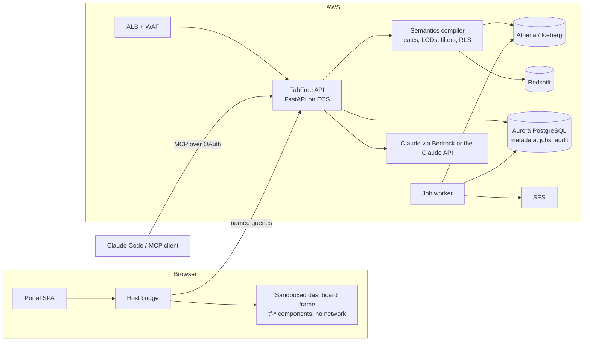

# Architecture

## Components

| Part | Where | What it does |
|---|---|---|
| Schemas | `packages/schemas` | JSON Schemas for manifests, models and the Tableau IR: the contracts between parts |
| Compiler | `packages/compiler` | Tableau's calc language, semantic queries to SQL with LODs, filters and RLS; TDVT conformance |
| Runtime | `packages/runtime` | Sandbox protocol, host bridge, `<tf-*>` components, table calculations |
| API | `apps/api` | Portal API, governed query service, permissions, authoring and MCP, migration console, jobs |
| Portal | `apps/portal` | The browser application |
| Migration | `packages/migrate` | Read-only Tableau crawler, converters and the migration factory |
| CLI | `packages/cli` | `tabfree` login, pull, push, validate, preview, publish, kit |
| Infrastructure | `infra/` | OpenTofu modules, the production environment, images, the Helm chart |

## The data path

1. The dashboard frame asks the host for a named query with the current filter state.
2. The API checks the person can view the dashboard, then compiles the query against the model: calcs,
   LODs, filters, parameters, sets and the person's RLS predicates.
3. The result cache is keyed by the compiled query, the RLS context and the model's data version.
4. On a miss the query runs on Athena (per-site workgroup and scan budget) or Redshift; results are
   capped, cached and returned. Table calculations run in SQL or in the runtime (ADR-004).

## Decisions

The architecture decisions are recorded as ADRs ([index](../adr/README.md)). The most load-bearing:
a purpose-built server (ADR-001), HTML bundles with a governed data contract (ADR-002), an own Tableau
semantics compiler (ADR-003), a Tableau-compatible permission engine (ADR-006), Iceberg on Athena and
Redshift with RLS in the application (ADR-007), a sandboxed Claude agent runtime (ADR-008), and ECS on
Fargate (ADR-009).
