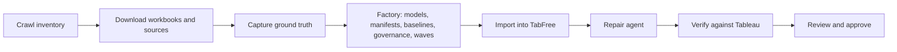

# Migrating from Tableau

The migration runs in phases, each of which can be repeated. All tooling is **read-only** against
Tableau Server: it uses the REST and Metadata APIs with a personal access token and, optionally, the
repository's read-only user. Tableau files are treated as untrusted (parsed with `defusedxml`, nothing
in them is executed).



## 1. Inventory and assessment

```bash
uv run tabfree-migrate smoke                      # checks the connection (TABLEAU_SERVER_URL, TABLEAU_SITE, TABLEAU_PAT_NAME, TABLEAU_PAT_SECRET)
uv run tabfree-migrate crawl                      # users, groups, projects, content, permissions, schedules
uv run tabfree-migrate harvest-metadata           # lineage and calculated fields from the Metadata API
uv run tabfree-migrate harvest-repository         # usage history (optional, repository access)
uv run tabfree-migrate report corpus/workbooks --out report
```

The report sizes the estate: features used, calculations that convert, data sources by type, and
content nobody has opened in the usage window (candidates to retire).

## 2. Downloads and ground truth

`download` fetches workbooks and published data sources (content-addressed, skipping unchanged
items). `capture` exports each view's PNG and the underlying data as CSV with the export options and
filter state recorded; these are what TabFree's output is compared against. Extracts are converted to
Iceberg with `convert-hyper` / `convert-batch`, and `parity-check` compares row counts and aggregates.

## 3. The factory

`factory.yaml` (`schema: tabfree/factory@0`) names the downloads, ground truth, inventory, the
data-source remapping rules (which Tableau connection becomes which Athena or Redshift table) and the
wave sizes:

```bash
uv run tabfree-migrate factory factory.yaml --out factory/
```

It writes a folder with semantic models, one dashboard bundle per Tableau dashboard (manifest, baseline
HTML, notes, the reference PNG and CSVs, a coverage report), the governance plan (people, groups,
projects, permissions, schedules, subscriptions, alerts, custom views, favorites, legacy URLs), waves
ranked by usage, and a decision queue for data sources the rules could not place.

## 4. Import, repair, verify, approve

```bash
uv run python -m tabfree_api.migration import factory/ --by admin
uv run python -m tabfree_api.migration repair --wave 1 --by admin     # Claude improves drafts
uv run python -m tabfree_api.migration verify --wave 1 --by admin     # data and visual parity
```

Each dashboard is a draft until approved. The **migration console** (`/migration`, site administrators)
shows every item with its fidelity score (coverage, data parity against the CSVs, visual similarity to
the PNG), the reference image beside TabFree's render, and the decision queue. Reviewers can request
changes, reopen, or approve; approval publishes with the Tableau owner, project and permissions,
registers the legacy URLs as redirects and restores favorites. The access-parity report compares who
can see each dashboard in Tableau and in TabFree and explains each difference.

Re-importing leaves approved items alone. At cutover, a **delta** run converts only what changed in
Tableau since a time and reopens affected approved items for review; see [Cutover](../operations/cutover.md).
